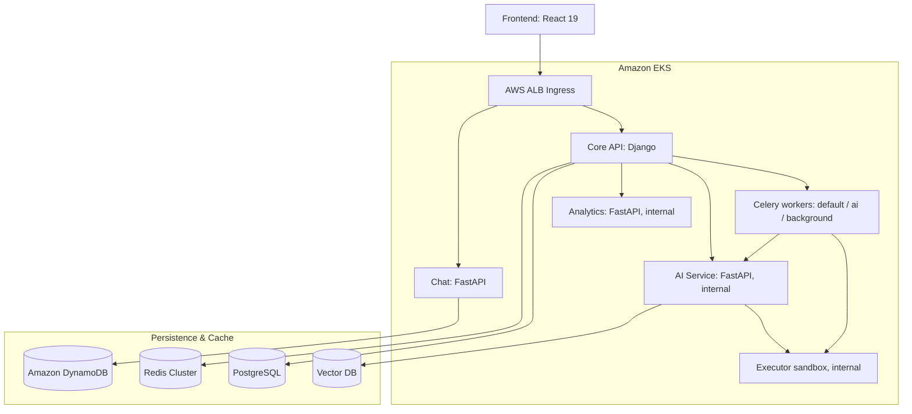

# CLASHCODE

ClashCode is a fun, game-like platform where you can learn and practice coding. Instead of just reading text, you solve challenges to unlock new levels and move through a digital world. With real-time chat and an AI mentor to help when you're stuck, it’s the perfect place to build your skills and connect with other coders.

---

### 🚀 Key Features

*   **🎮 Gamified Progression**: Master coding concepts through a dynamic, level-based game world.
*   **🤝 Real-Time Chat**: Global messaging hub with presence tracking and persistent history via DynamoDB.
*   **🤖 AI-Powered Mentorship**: RAG-based AI tutor providing contextual hints and automated code analysis.
*   **⚡ Secure Execution**: Untrusted code runs in a fresh, resource-limited sandbox process per run, inside a pod with no secrets and no network (gVisor in production).
*   **📊 Analytics & Monitoring**: Real-time cluster telemetry and health diagnostics via Prometheus.

---

### 🏗️ Architecture

CLASHCODE is orchestrated on **Amazon EKS** and leverages a distributed topology for maximum scalability.

---

### 🛠️ Technology Stack
*   **Frontend**: React 19, Vite, Zustand, Tailwind CSS, Framer Motion
*   **Backend**: Python (FastAPI, Django), Celery
*   **Databases**: PostgreSQL, DynamoDB, Pinecone, Redis
*   **Infrastructure**: Kubernetes (EKS), Docker, AWS, Terraform

---

### 🔒 Security Posture

*   **Isolation**: Each run is a fresh `python -I -S` process with a clean environment, rlimits (CPU, memory, no files, no fork) and a hard timeout. The executor pod holds only its own key, mounts no service-account token, has deny-all egress, and runs under gVisor in production.
*   **Integrity**: A level only passes when the trusted test harness reports success with a per-run token, so `exit()` tricks don't count. Levels unlock server-side.
*   **Secrets**: Per-service Kubernetes Secrets synced from AWS Secrets Manager by External Secrets; nothing secret is committed.
*   **Identity**: HttpOnly JWT cookies (never `localStorage`), refresh-token revocation on logout, verified-email-only OAuth linking. Pods reach AWS through IRSA.
*   **Validation**: An AST pre-check rejects obviously dangerous code early. It is a convenience; the sandbox is the boundary.

See `CLAUDE.md` for the production-readiness checklist.

---

### 📄 License
Licensed under the **MIT License**.

